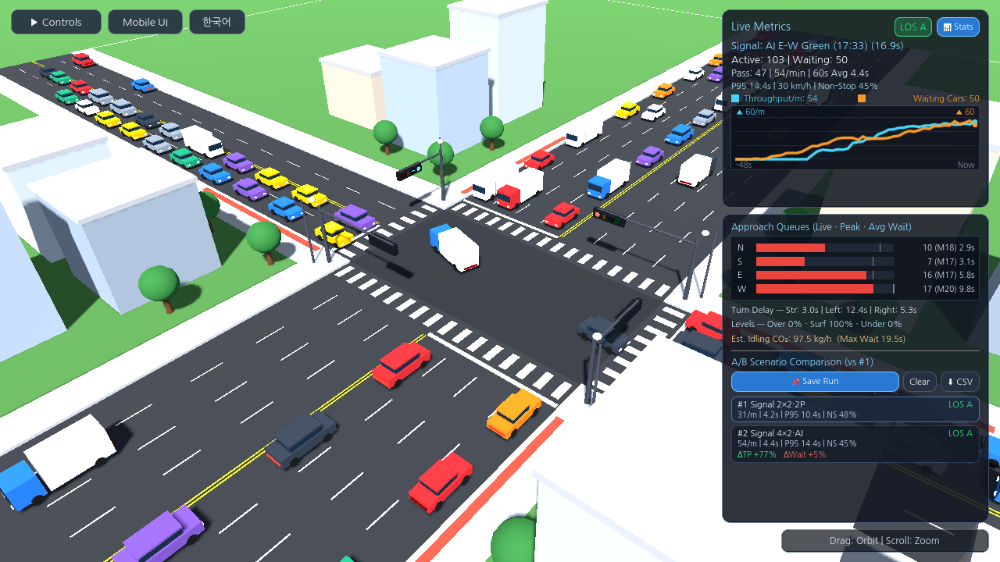
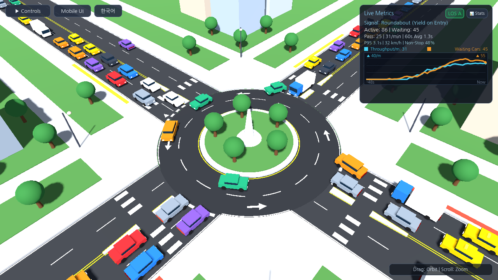
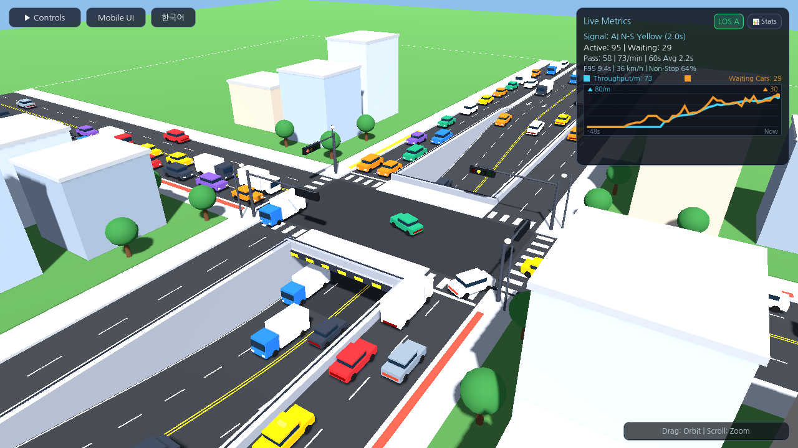
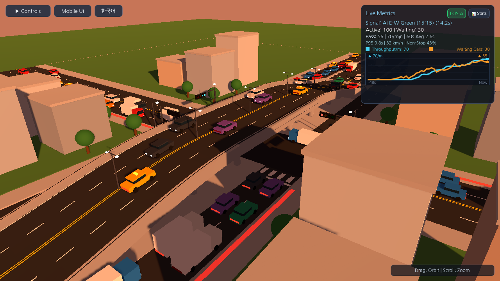
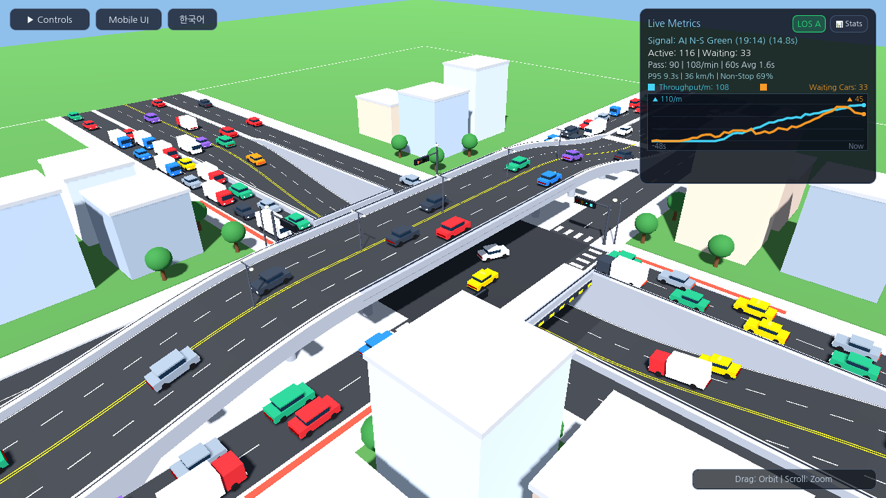
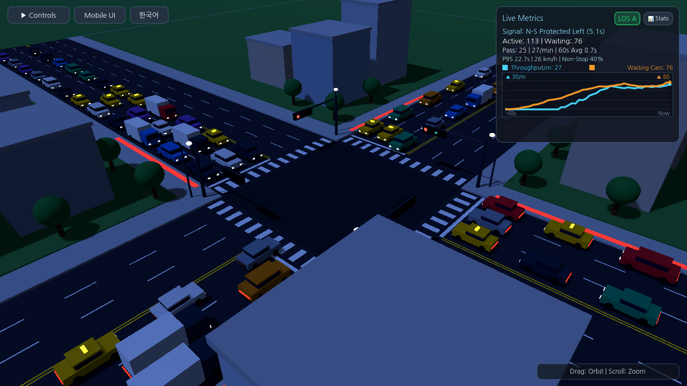

# 3D 교차로 교통 시뮬레이터 (Godot 4.3 + Vercel Web Export)

Godot 4.3으로 개발된 3D 교차로 교통 흐름 시뮬레이터입니다. 데스크톱(Godot 4.3)과 웹/모바일 브라우저(HTML5/WebAssembly, Vercel 정적 배포) 모두에서 실행됩니다.

- **라이브 데모 (Vercel):** https://intersection-simulator-3d.vercel.app
- **저장소:** https://github.com/knoxxr/intersection-simulator-3d

## 스크린샷

| 신호 교차로 AI 감응 & 실시간 통계 / A·B 비교 | 회전교차로 (로터리) |
|---|---|
|  |  |

| 지하차도 입체교차 | 고가교 입체교차 (노을 모드) |
|---|---|
|  |  |

| 3층 입체교차 (고가 + 지상 + 지하 동시 운영) | 야간 모드 & 4현시 좌회전 보호 신호 |
|---|---|
|  |  |

## 주요 기능

- **5가지 교차로 구조 실시간 전환**:
  - **신호 교차로**: 1~10차선 비대칭 차선 구성, 단면형 3D 신호등 및 좌회전 화살표(`←`) 렌즈
  - **회전교차로 (로터리)**: 곡선 차선, 양보선/상어이빨(`▽`), 교통섬, 회전 차량 우선 양보 AI
  - **지하차도 입체교차**: 경사 램프(`-5.4m`), 터널 포털·천장 LED, 지상 측도 분리 주행
  - **고가교 입체교차**: `+6.0m` 고가 교량, T형 교각, 고가 가로등 및 하부 교차로 동시 주행
  - **3층 입체교차**: 남북 고가교(`+6.0m`) + 지상 교차로 + 동서 지하차도(`-5.4m`) 동시 운영
- **스마트 감응식(AI) 신호등 & 긴급차량 우선신호**:
  - `스마트 감응 (AI)`, `2현시`, `4현시 (좌회전 보호 신호)`, `황색 점멸`, `전체 적색`
  - **구급차 긴급 출동**: 경광등이 점멸하는 3D 구급차 투입 시 해당 진행 방향 우선 녹색 전환
- **교통공학 수준 실시간 통계 & A/B 비교**:
  - HCM 기준 **`LOS A~F`** 등급 배지, 60초 롤링 평균 대기, **P95 대기시간**, 평균 통과 속도(`km/h`), 무정차 통과율(`%`)
  - **방향별 대기열 막대 차트(`N/S/E/W`)**, 회전별(직진/좌/우) 평균 대기, 층별 통과 분담률(고가/지상/지하), 추정 공회전 CO₂ 배출량
  - **시나리오 A/B 스냅샷 비교**(최대 4개 저장, `#1` 대비 처리량·대기시간 증감률 자동 계산) 및 **CSV 리포트 다운로드**
- **시간대 조명 & 반응형 다국어 UI**:
  - `낮` / `노을` / `야간` 시간대 조명, 진입부 연석 실시간 혼잡도 색상 표시
  - 영어/한국어 실시간 전환, 데스크톱·모바일 반응형 UI 및 멀티터치 카메라 지원

## 실행 및 배포

### 1. Godot 4.3 데스크톱 실행
```bash
godot4 --path .
```

### 2. Web 빌드 생성 (HTML5/WASM)
```bash
godot4 --headless --path . --export-release "Web" web_build/sim_v20.html
mv web_build/sim_v20.html web_build/index.html
```

### 3. Vercel 배포
- [Vercel에서 바로 Import하여 배포하기](https://vercel.com/new/import?s=https://github.com/knoxxr/intersection-simulator-3d)
